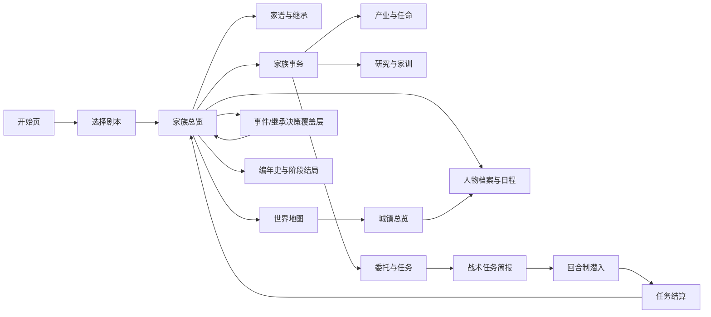

# 统一界面路线图
本文件由原始 Markdown 文档合并而成。各节保留原文，标题中的来源路径用于追溯。
## 目录
- [docs/superpowers/plans/2026-11-09-m04-m08-ui.md](#2026-11-09-m04-m08-ui)
- [docs/superpowers/specs/2026-11-09-m04-m08-ui-master-design.md](#2026-11-09-m04-m08-ui-master-design)

---

## 来源：docs/superpowers/plans/2026-11-09-m04-m08-ui.md

# M04–M08 全局 UI 实施计划

> **For agentic workers:** REQUIRED SUB-SKILL: 使用 `superpowers:executing-plans` 跟踪任务；代码由 Orca 监督下的 OpenCode2 实现，并按项目 `AGENTS.md` 顺序请求独立只读复审。每项任务完成自身验证后才能进入下一阶段。

**Goal:** 按统一 UI 系统交付 M04–M08 游戏界面，使已批准玩法具有完整可操作布局，未定玩法在规则确认后再从结构蓝图深化。

**Architecture:** 沿用现有 uGUI 页面、`SengokuUiTheme`、领域快照和命令，不另造一套 UI 框架。按 M## 分段集成：M04 家族/人物、M05 经营/委托、M06 战术、M07 跨模式整合、M08 内容与易用性；每段使用现有 EditMode 测试与 FoundationScene 验证，场景由指定集成者在已打开 Editor 中接入。

**Tech Stack:** Unity 6.6.6f1、C#、现有 uGUI 与项目 asmdef、Unity EditMode Test Runner、FoundationSceneValidator；不增加包。

**Spec:** [M04–M08 全局 UI 设计稿](UI_ROADMAP.md#2026-11-09-m04-m08-ui-master-design)，玩法规则以 [GDD_v4.0.md](../GDD_v4.0.md) 和各节点已批准设计稿为准。

## Global Constraints

- 参考画布为 1280×720，宽高比 16:9；窄屏保留安全边距并允许正文滚动。
- 游戏内主导航固定为「家族｜人物｜地图｜委托｜编年史」。
- 页面只呈现真实会话/领域数据；不以假人物、假资源或无功能设施卡填充。
- 开发诊断保持只读并与玩家界面分离；高风险动作确认前显示条件、成本、风险和后果。
- 关键状态不只依赖颜色或 hover；页面覆盖正常、空、不可用、处理中、完成、失败/中断及长内容溢出状态。
- 沿用现有项目和工作区，不创建 Unity 项目、分支或 worktree；保护现有未提交 WIP、`.meta` GUID、`Library` 和 `Temp`。
- 不安装包、不使用付费素材/服务、不复制商业游戏资产；新 UI 素材按 `docs/ART_ASSET_WORKFLOW.md` 生成并记录到 `ASSETS.md`。
- OpenCode2 实现 C# 与数据绑定；场景/Prefab/ProjectSettings 只由指定集成者在项目现有 Unity Editor 单写者编辑。
- 不对持有当前 Editor 的目录运行 batchmode；分别记录编译、EditMode、场景 Validator、Console、Play Mode 与最终验收。
- 每次 Unity 验证前检查 Editor 进程及 `-projectPath`，只使用指向 `C:\Users\panye\My project` 的现有 Editor；从该 Editor 的 Test Runner 和 `Editor.log` 取证。
- 每个阶段通过对应验证后，只提交并推送该阶段已验证文件；最终里程碑合并、打 tag 需用户明确验收。

## Review Focus

- **大名单/长姓名与关系网扩展：** 页面不得重叠或缩小到不可读；在 M04 人物/家谱任务覆盖滚动、聚焦与长名测试。
- **空数据或缺条件：** 不得显示假数值或误导性可用按钮；在各拥有列表/候选操作的任务覆盖空状态和禁用原因。
- **取消/确认与重复提交：** 取消不得改领域状态，确认只应用一次；在关系、任命、委托和战术任务覆盖命令结果及状态断言。
- **窗口尺寸及可读性：** 16:9 与较窄窗口保留关键操作、焦点和说明；在共享布局与 M08 任务覆盖边界/焦点验证。
- **跨页状态与错误恢复：** 导航不推进时间、不丢选中对象；保存错误保留原存档并说明原因；在 M07/M08 整合任务覆盖往返导航和存档失败状态。

---

## 文件与职责地图

- `Assets/Scripts/Presentation/SengokuUiTheme.cs`、`SengokuUiArt.cs`：沿用共享色板、字体/图像绘制和纸本/墨色样式；只在跨页面确有缺口时扩充。
- `Assets/Scripts/Presentation/CharacterDailyPageView.cs`、`NpcAiInspectorPanel.cs`、`FamilyRosterPanel.cs`、`FamilyTreeGraph.cs`、`SuccessionPanel.cs`：M04 人物、关系、家谱、继承和只读诊断现有入口。
- `Assets/Scripts/Presentation/FamilyFormationPanel.cs`、`FamilyResearchPanel.cs`、`CharacterEducationPanel.cs`、`FamilyDoctrinePanel.cs`、`IndustryPanel.cs`：M05 已有领域面板，优先调整布局和信息层级。
- `Assets/Scripts/Presentation/WorldMapController.cs`、`TownOverviewPanel.cs`、`EventChoicePanel.cs`、`FamilyChroniclePanel.cs`：跨页面导航、地方/事件上下文与历史结果的复用入口。
- `Assets/Scenes/FoundationScene.unity` 和其 `.meta`：页面根、现有绑定和导航的唯一整合场景；保持现有 GUID，不创建新场景。
- `Assets/Tests/EditMode/` 中对应 `*PanelTests.cs`、家谱布局测试、`ReferenceGalleryNavigatorTests.cs` 和 `FoundationSceneValidator`：页面投影、操作结果、场景绑定与结构验证。
- M06 若需新增战术视图脚本，其名称/接口在 M06 玩法设计批准后另写节点计划；本总计划不预设战术规则或投影方式。

## 实施顺序与门槛

M04A 个人记忆 UI 已包含在单独的 M04A 实施任务中，不与本计划并行改动相同页面。其余阶段按 M04 → M05 → M06 → M07 → M08 顺序推进；每个阶段在实现前核实对应玩法设计已批准。当前总稿中的蓝图不能代替具体玩法规则或 Play Mode 验收。

### Task 1: M04 人物档案、动态名册与家谱

**Files:**
- Modify: `Assets/Scripts/Presentation/CharacterDailyPageView.cs`
- Modify: `Assets/Scripts/Presentation/FamilyRosterPanel.cs`
- Modify: `Assets/Scripts/Presentation/FamilyTreeGraph.cs`、`FamilyTreeLayout.cs`
- Test: `Assets/Tests/EditMode/FamilyRosterPanelTests.cs`、`FamilyTreeGraphTests.cs`、`FamilyTreeLayoutTests.cs`
- Integrate: `Assets/Scenes/FoundationScene.unity`（由指定集成者操作）

**Interfaces:** 读取现有稳定 PersonId、人物快照和 kinship graph；保持既有选择、查看和继承命令签名，不在 UI 层生成亲属事实。

- [ ] 先为动态人数、长姓名、空关系和横纵溢出补充 EditMode 断言；无数据时不显示不存在的亲属关系。
- [ ] 沿用现有关系图布局为世代标记、可滚动画布和选中人物详情栏；固定人物卡最小可读宽度。
- [ ] 在人物档案中区分事实关系、个人经历和当前状态；选中人物随页面导航保留。
- [ ] 运行对应家谱与名册 EditMode 测试；预期所有布局边界和数据投影断言通过。
- [ ] 在 FoundationScene 中单根接入并通过 FoundationSceneValidator；不得重建已有场景对象或更改其 GUID。
- [ ] 记录编译、EditMode、Validator、Console 和 Play Mode 证据，分别请求只读复审后提交推送本任务验证文件。

### Task 2: M04 婚姻/收养和继承决策页面

**Files:**
- Modify: `Assets/Scripts/Presentation/FamilyFormationPanel.cs`、`SuccessionPanel.cs`
- Test: `Assets/Tests/EditMode/FamilyFormationPanelTests.cs`、`SuccessionServiceTests.cs`、`SuccessionSaveTests.cs`
- Integrate: `Assets/Scenes/FoundationScene.unity`（由指定集成者操作）

**Interfaces:** 使用 SC-022 已批准的婚姻/收养校验结果和现有继承/摄政 outcome；若目标操作或领域规则未落地，先停在界面设计，不虚构命令。

- [ ] 为候选关系路径、禁用原因、确认后预览及取消不变更状态编写 EditMode 断言。
- [ ] 将候选人/现有关系/校验结果/预览组织到家族事务页；仅领域规则允许时启用确认。
- [ ] 将继承资格、支持分布、后果和风险组织到家谱详情栏；危机决定按最高优先级覆盖层呈现。
- [ ] 运行婚姻收养、继承面板和存档回归测试；确认 UI 不绕开 validator 或改变存档事实所有者。
- [ ] 接入场景、执行 Validator 和 Play Mode；复审通过后仅提交已验证文件并推送。

### Task 3: M05 家族总览、产业与任命

**Files:**
- Modify: `Assets/Scripts/Presentation/IndustryPanel.cs`、`CharacterDailyPageView.cs`、`FamilyChroniclePanel.cs`
- Test: `Assets/Tests/EditMode/IndustryPanelTests.cs`、`IndustryAssignmentSessionTests.cs`、`IndustrySaveTests.cs`
- Integrate: `Assets/Scenes/FoundationScene.unity`（由指定集成者操作）

**Interfaces:** 使用现有 `IndustryView`、assignment outcome、当月计划和 session 命令；不在面板计算或改变经营结算。

- [ ] 为总览布局、本月事件空/多数据、产业无负责人、候选冲突和确认/取消行为补 EditMode 断言。
- [ ] 按设计稿接入家主/日期侧栏、家庭成员与任命表、本月事件、待处理事项和固定结束月区。
- [ ] 在产业详情展示已有地点、投入、维护、产出、风险与任命预览；缺省字段隐藏并解释当前不可用原因。
- [ ] 运行产业面板、任命会话和存档测试，验证重复提交不会重复分配或结算。
- [ ] FoundationScene 集成、场景验证、Play Mode 和只读复审通过后提交推送本任务文件。

### Task 4: M05 研究、教育、家训/抱负与委托入口

**Files:**
- Modify: `Assets/Scripts/Presentation/FamilyResearchPanel.cs`、`CharacterEducationPanel.cs`、`FamilyDoctrinePanel.cs`
- Modify only after commission rules are approved: existing mission panel/session files or the exact files named by its node plan.
- Test: `FamilyResearchPanelTests.cs`、`CharacterEducationPanelTests.cs`、`FamilyDoctrinePanelTests.cs`、对应 session/save tests。
- Integrate: `Assets/Scenes/FoundationScene.unity`（由指定集成者操作）

**Interfaces:** 研究、教育、家训和抱负读取已有 SC-020/021/024 view/state/outcome；委托用 GDD 与独立批准的 M05 规则稿确定的请求/结果类型。

- [ ] 为空研究、无导师、不可选目标、已生效家训和阶段进度编写 UI 投影断言。
- [ ] 将研究进度/投入/收益、教育学员/导师/计划、家训生效行为/抱负进度分为独立详情区。
- [ ] 委托页面只在接取、结算、投入、检定和失败规则已批准后实现；规则未批准时不新增假选项或假后果。
- [ ] 运行已有面板、session、save/load 测试，确认跨月状态与取消操作符合领域 outcome。
- [ ] 完成场景、Play Mode、复审和本阶段已验证文件推送。

### Task 5: M06 任务简报、战术地图、结算（规则批准后）

**Files:**
- Create/Modify: M06 专属 Presentation 脚本和 EditMode 测试，具体路径以用户批准的 M06 玩法设计与后续节点计划为准。
- Integrate: `Assets/Scenes/FoundationScene.unity`（由指定集成者操作）

**Interfaces:** 接受 M06 任务/队员/地图快照和动作 outcome；将完成、失败或撤退结果交回现有会话事务，不在 UI 直接写游戏状态。

- [ ] 在开始实现前先批准 M06 操作规则（地图投影、移动、视野、警戒、行动限制、撤离和回写）；未批准则本任务保持未开始。
- [ ] 为情报未知、队员伤势、合法/非法行动、成功/失败/撤退和未提交结果编写断言。
- [ ] 实现简报、战术主画布与任务结算三个结构区；地图样式与可用动作从 M06 规则读取。
- [ ] 测试结果只回写一次，并验证保存/载入保留结果；由指定集成者接入场景并运行 Validator。
- [ ] 通过实际 Play Mode 成功路线和失败/撤退路线、Console 归零和只读复审后提交推送。

### Task 6: M07 跨模式导航和结果回写

**Files:**
- Modify: `Assets/Scripts/Presentation/ReferenceGalleryNavigator.cs`、`CharacterDailyPageView.cs`、`WorldMapController.cs`、`FamilyChroniclePanel.cs`
- Test: `Assets/Tests/EditMode/ReferenceGalleryNavigatorTests.cs`、`GameSessionMissionTests.cs`、`GameSessionChronicleTests.cs`、存档回归测试。
- Integrate: `Assets/Scenes/FoundationScene.unity`（由指定集成者操作）

**Interfaces:** 复用 M04–M06 页面导航和战术 outcome 命令；不在导航间推进日期或复制人物/战斗历史记录。

- [ ] 为家族→人物→地图/任务→结算→家族往返导航编写状态保留断言，确认选择对象与月份不丢失。
- [ ] 为任务准备中的人物行动冲突添加明示提示；自动委派与手控差异仅使用已批准规则。
- [ ] 将单次结算关联到执行人物、家族事件和编年史，并验证继承后稳定 ID 归属。
- [ ] 运行导航、任务会话、编年史和存档回归；FoundationScene Validator 与 Play Mode 完成全路径后复审并提交推送。

### Task 7: M08 剧本、结局、存读档与可访问性

**Files:**
- Modify: `Assets/Scripts/Presentation/TitleScreenController.cs`、`DemoSummaryPanel.cs`、`SaveLoadPanel.cs`、共享 `SengokuUiTheme.cs`（仅限已支持的显示设置）。
- Test: `Assets/Tests/EditMode/TitleScreenControllerTests.cs`、`DemoSummaryPanelTests.cs`、`SaveLoadPanelTests.cs` 与场景验证。
- Integrate: `Assets/Scenes/FoundationScene.unity`；若需要设置页只复用真实可配置选项。

**Interfaces:** 读取已发布剧本列表、阶段结局结果和现有存档 API；不增加未经实现的自由剧本、评分或设置字段。

- [ ] 为已开放/未开放剧本、结局历史和无旧存档状态编写清楚可用性断言。
- [ ] 按时间轴展示已发生继承与后果；所有评价维度映射至 GDD 已批准数据。
- [ ] 检查 1280×720 与较窄窗口、安全边距、键盘焦点、文字放大/对比能力；不能提供的选项不展示。
- [ ] 验证保存失败时旧档案保留、存档迁移提示清楚；运行所有相关 EditMode 测试和 FoundationScene Validator。
- [ ] 完成多代完整 Play Mode、Console 零错误、存读档与用户验收后，只提交该阶段验证文件；用户明确验收后才可做最终 checkpoint/merge/tag。

## 阶段结束证据

每一阶段分别记录：Unity 编译结果、EditMode 测试数量与结果、场景 Validator、Console 错误/警告数量、Play Mode 使用的确切项目路径与实测流程、存档验证（若在范围内）、只读复审结果。不得用 EditMode、静态检查或旧日志代替 Play Mode 证据。所有 Computer Use 截图检查后立即删除，并清理专用临时缓存。

---

## 来源：docs/superpowers/specs/2026-11-09-m04-m08-ui-master-design.md

# M04–M08 全局 UI 设计稿

**状态：** 用户已批准（2026-11-09）；进入分阶段实现计划  
**设计权威：** [GDD_v4.0.md](../GDD_v4.0.md)；具体系统规则仍由各 M## 设计稿和用户确认决定。  
**范围：** M04 人物记忆与动态家族、M05 经营与委托、M06 回合制潜入、M07 三层整合、M08 内容与正式体验。

## 意图

为尚未收敛的游戏界面建立一套能跨家族经营、人物活动和战术任务复用的界面系统。继续使用已确认的《影之一族》UI 参考风格；有确定规则的页面给出可供实现计划直接拆解的布局、交互与状态，无确定规则的页面只锁定信息层级和区域职责，不提前替玩法作决定。

## 设计原则

- **一个世界状态，多种操作界面。** 页面只呈现现有会话/领域数据；界面切换不暗中推进时间、提交结果或更改存档。
- **家族经营是主界面，人物页承接个人操作，战术页是受任务约束的专用模式。** 全局日期、地点和资源持续可见，转入战术时明确显示任务上下文。
- **玩家可见信息与开发诊断分开。** AI Inspector 保持只读、可折叠并标注开发用途；普通人物页不显示内部评分细节。
- **先呈现决定和后果，再呈现数据。** 数值配短标签、变化方向和原因；危险、消耗、延期和失败条件在确认前可见。
- **空、锁定、未知和不可用状态必须说清楚。** 不用无功能的设施卡、伪造传闻、假人物或虚构资源填版面。

## 方案比较

| 方案 | 内容 | 取舍 |
|---|---|---|
| 每个系统各自制作页面 | 页面可以独立深入，但重复导航、按钮、资源条和反馈样式，跨模式容易割裂。 | 不采用 |
| 统一全局界面系统，按玩法分组设计页面（本稿） | 统一导航、材质、状态和操作反馈；按 M## 将已有规则做成详细页面，将未定玩法做结构蓝图。 | **采用**；减少重复，同时不冻结尚未批准的玩法规则。 |
| 先把所有未来页面画成最终像素稿 | 视觉完成度高，但战术、委托和动态家族细节仍在变化，返工会扩大。 | 暂不采用；相关规则定稿后再深化视觉稿。 |

## 现有设计锚点

本稿扩展现有确认结果，不重做其设计来源：

- [五张 UI 参考图设计稿](archive/design-and-planning-history.md#2026-11-07-ui-reference-gallery-design)：人物档案/行动、家族内务、家谱/继承、地图/出行、事件抉择，是游戏内页面构图基准。
- [开始页面设计稿](archive/design-and-planning-history.md#2026-11-08-start-screen-design)：主菜单与剧本选择分层。
- [城镇总览设计稿](archive/design-and-planning-history.md#2026-11-08-town-overview-ui-design)：清洲、热田、那古野分别保持不同插画与地点重点。
- 人物每日行动、教育、婚姻/收养、产业、研究、家训/抱负、委托和事件面板已有代码或纵向设计；本稿指定它们如何进入统一页面体系，不假定它们已完成视觉验收。

## 视觉与布局系统

沿用现有 `SengokuUiTheme` 色值和 UI 素材流程：深靛色外框、古金分隔、羊皮纸内容面、朱印主操作、苔玉只表示正向/安全状态。纸纹只用于内容面，避免文字下高对比噪点；深色框架承担导航和全局状态。按钮、图标、印章、肖像边框必须是独立 UI 元素，禁止把整张界面烘焙进背景图。

### 统一画布与分区

- 逻辑参考画布为 1280×720，宽高比 16:9；以 `CanvasScaler` 按屏幕尺寸缩放。16:9 与较窄窗口都要保留安全边距，窄屏优先允许正文区滚动，不压缩正文到难以阅读。
- 全屏页面共享顶栏：左侧家纹/标题和当前主区；中部日期、季节、地点；右侧关键资源、待处理提示和系统入口。资源只显示当前页面/运行状态真实提供的字段。
- 游戏内主导航固定为「家族｜人物｜地图｜委托｜编年史」；当前主区用朱印/金线标示。开发诊断入口不加入玩家导航。
- 导航下方由页面标题、上下文说明和正文组成。正文采用“主工作区 + 可选右侧详情栏”；详情栏没有内容时整栏收起，不能压缩主内容。
- 确认、结算、继承和高风险命令使用页面内的固定操作区；普通查看和返回操作不与主操作使用同等强调。
- 弹窗只用于需要玩家立即作决定的事件、继承/摄政、出行确认、保存错误等；不把整页常驻系统做成层层叠加的浮窗。

### 基础视觉标尺

| 层级 | 规格方向 | 用法 |
|---|---|---|
| 页面标题 | 30–36 px，书写感标题字 | 当前主区域和重大决策标题 |
| 分区标题 | 21–25 px，较重字重 | 家族、人物、任务和数据区段 |
| 正文 | 17–20 px，行距舒展 | 说明、日志、关系与任务描述 |
| 辅助标签 | 15–17 px | 日期、状态、属性名；低于此范围只用于非关键装饰 |
| 主按钮 | 朱红底/浅字/金边 | 提交、确认、出发、结算等有明确后果的动作 |
| 次按钮 | 深靛或浅纸底 | 打开、返回、筛选、切换视图 |
| 危险状态 | 暗朱/警示图形/明确文案 | 伤势、风险、会失去内容或不可逆结果 |

标题字体沿用现有 CJK 宋/楷回退，不随界面引入字体包。所有关键状态不能只靠颜色区分，图标/文字同时说明。头像、家纹、地点插画按 [ART_ASSET_WORKFLOW.md](ART_ASSET_WORKFLOW.md) 生成并登记 `ASSETS.md`；不得复制商业游戏美术或其专有图标。

### 通用组件

- **人物卡：** 头像/姓名/身份与家族关系/年龄或状态；点击只改变选中对象，详情在同页或详情栏展开。
- **关系边：** 亲属类型使用线型/标签区分；不能只用颜色表达血缘、婚姻、收养或主从。
- **资源条：** 当前值、变化量和来源三列；无变化量时不留空白占位。
- **任务/事件卡：** 目的、期限、参与人、投入、可能结果和当前阶段；未可行动时说明缺少条件。
- **决定面板：** 选项、条件、可见成本、风险和可能后果；未确认选项不会更改状态。
- **时间轴：** 日期、人物、事件和承担后果者对齐；区分个人经历、家族编年史与当前世界状态。
- **状态提示：** 已安排/进行中/完成/中断/延期/失败有稳定文案和图标；重要状态不依赖 hover 才能理解。

## 导航与页面关系

常驻页切换保留当前选中人物/月份/地图选择；重大决定覆盖层暂停需要玩家注意的时间推进。进入/离开战术模式要明确展示任务标题和返回经营界面的结果入口。

## M04：人物记忆与动态家族

### 人物档案、经历与记忆

沿用人物参考页三栏：左侧家族/人物导航，中部人物档案和关系网，右侧日程与只读诊断。M04A 记忆放在中部“经历”标签和开发 Inspector 的只读记忆区：每条显示发生日期、行动、完成/中断、当前是否影响评分；评分解释列出基础分、修正和最终分。普通玩家档案不直接呈现 AI 内部候选分，只有可理解的经历摘要。详细行为服从已批准的 M04A 设计稿。

### 动态家族名册与家谱

沿用家谱参考页的世代连线和人物卡，不固定六人/三代。左侧纵向世代标记，中部可滚动的亲属关系图，右侧显示选中人物的身份、当前家主/继承资格/存活与离家状态、亲属事实来源。图超出屏幕时使用二维滚动或聚焦选中人物，不压缩卡片到文字不可读。不存在的关系、继承资格或角色不显示为已确认事实。

### 婚姻与收养管理

以“家族事务 > 婚姻与收养”列表为入口：上部为当前家庭关系摘要，下部左右列显示可管理人物与候选人；选中候选后显示现有亲属路径、可执行操作、校验结果与关系图预览；确认按钮仅在领域规则允许时启用。多位正式配偶、既有禁配规则和防止收养亲子循环的规则沿用 SC-022，UI 不自行重定义资格。

### 继承、摄政与家族危机

使用家谱页面右栏的“继承与家督详情”，对继承/让位/任命摄政显示人物资格、支持信息、预览后果和风险。幼主继位时用独立高优先级决策覆盖层说明受限决策和交权时间；没有合资格摄政时展示 GDD 已定义的危机路线。UI 不允许直接拖拽改写亲属事实。

## M05：经营与委托

### 家族总览与月度内务

以家族参考图第三页为基准：左侧家族徽记/主家/家主和日期，中部为成员任命表与本月事件，右侧为天下动向和待处理决策，底部固定“保存”和“结束本月”。每行显示人物职责、本月安排、状态和可解释的资源/关系变化；事件只在有真实状态时显示。结束月前汇总即将执行的工作、到期委托、可能暂停条件和预计资源变化。

### 产业与人员任命

产业页采用“产业列表 + 选中产业经营详情 + 可任命人员栏”。每项产业显示地点、负责人、投入、维护、产出和当前风险；任命交互采用候选比较与确认预览，展示岗位适配/冲突以及月结变化。无可用数据时显示尚未建立/无人任命，不给空建筑生成经营入口。

### 研究、教育、家训与抱负

这些功能保持领域分区而非塞进单一大表：家族研究/技艺在家族事务中；子女教育在人物档案和教育安排中；家训与家主/个人抱负在家族治理页。研究详情显示 prerequisites、当前进度、投入和收益；教育显示学员、导师、年度计划和已产生变化；家训/抱负显示当前生效的行为与可追踪进度。具体值沿用 SC-020/021/024，未来规则待其设计稿批准。

### 委托与任务

委托列表按“可接/进行中/待结算/已结束”分组，任务详情显示雇主、目的、参与人物、期限、资金/物资投入、检定要素和可能失败后果。确认前可返回修改人员与投入；接受后有可见的占用状态。任务完成页用结果摘要呈现成功、部分成功、失败或撤退，再列资源、伤势、关系和编年史回写。首版只实现 GDD 已批准的有限委托，不提供通用任务编辑器。

## M06：回合制潜入

本节是结构蓝图，锁定页面职责，不预设尚未批准的数值、行动点、技能树或敌人规则。

### 任务简报与准备

纸面任务卷轴式简报：左侧任务目标/情报可信度/期限，中部区域草图与已知路线，右栏队员及其伤势/能力，底部选择方案、人员并确认出发。未知地形明确标“情报不明”；不以完整地图展示玩家未知内容。

### 战术地图

战术视图切换为深墨夜色和低饱和地形底，继续保留古金选中边线与朱印警戒反馈。中央为战术地图主画布；左侧队伍与当前角色；右侧目标/警戒/选中单位状态；底部为当前规则允许的行动按钮和结束回合。敌人视野、噪音/警戒和可撤离路线按 GDD 表现；每次移动/行动有即时范围、风险和结果反馈。投影方式、格网形式、按钮内容和行动限制由 M06 规则稿定义。

### 任务结算

用一页可读的任务记录替代瞬时奖励弹窗：任务结果、完成/撤退状态、人物伤势/经历、资源/信用变化、敌方反应和返回地图/家族入口。被拒绝的回写需要说明失败原因，避免把未提交结果显示成既成事实。

## M07：三层玩法整合

全局顶栏和家族导航在经营/个人/战术模式间保持稳定，但当前模式有明显标题和主色强调。任务准备前展示“家族职责与人员当前行动冲突”；允许选择玩家控制或自动委派的细节由 GDD 19.8 的后续决策确定。战术返回后使用统一结算记录，把结果链接到执行人物、家族事件和编年史；不做重复的独立人物/战斗档案。

## M08：内容扩展与正式体验

- **剧本/继续流程：**沿用开始页和选剧本页；介绍剧本时区分固定剧本、自由家族/动态成员等已实现与待开放内容。
- **阶段结局：**突出家族延续、当前家主与重大选择；下方按时间轴解释两次继承及后果，再提供继续模拟/开始新剧本入口。结局评价只使用 GDD 已有维度，不显示未经确认的综合分。
- **保存/设置/可访问性：**沿用现有存读档入口；新增设置项仅在真实支持时展示。字号、对比、音量和键鼠提示依实现能力纳入正式体验验收，不伪造选项。
- **内容容量：**人物、地点、事件和产业增长时继续复用卡片/列表/时间轴组件；多内容采用筛选、滚动和详情栏，不以缩小字体解决溢出。

## 关键状态与覆盖优先级

覆盖顺序为：紧急不可逆决定（继承/危机）→当前事件抉择→任务完成/伤病等需处理结果→普通提示→常驻页面。多个事件排队时显示数量和后续顺序；玩家可以查看当前决定上下文，但在规则暂停期间不能绕过它推进月份。保存/读档错误显示在系统层，保留原存档并提供可理解的原因。

主要页面至少设计以下显示状态：正常数据、无内容、不可用/缺条件、已完成、处理中、失败/中断、长名称/关系网溢出。键盘焦点和鼠标悬停不能是获取关键说明的唯一方式。

## 实现边界与顺序

1. M04A：人物记忆接入现有档案与只读 Inspector（本轮独立开发任务进行中）。
2. M04 剩余：动态名册/家谱变更、家庭关系和继承页面；具体领域规则须逐项批准。
3. M05：家族总览、产业/任命、任务/结算，先打通一个可玩委托再扩展表格。
4. M06：先完成任务简报与战术地图核心画面，再扩充反馈和结算。
5. M07：复用既有页面整合导航和跨模式回写状态。
6. M08：剧本、结局和易用性补齐，按试玩结果细化。

每一片按单独 M##/SC## 实现计划、复审、EditMode/场景验证/Play Mode 交付。场景结构改动仍由指定集成者在现有 Editor 中单写者完成；素材按项目美术流程生成，代码交 OpenCode2；未通过验证的页面只记为设计或实现中，不视为已验收。

## 待未来节点确认的产品决定

- 动态家族人物由哪些世界规则生成、NPC 可自主执行哪些婚姻/离家/委托行为。
- 委托的确切选择空间、属性检定、时间/资源成本与失败后果。
- 战术操作细节与自动委派/手动控制的策略差异。
- M08 自由剧本、长线内容容量、结局指标与设置选项。

在对应 M## 开始前由用户按该节点设计稿确认，不在本 UI 总设计中猜定。
